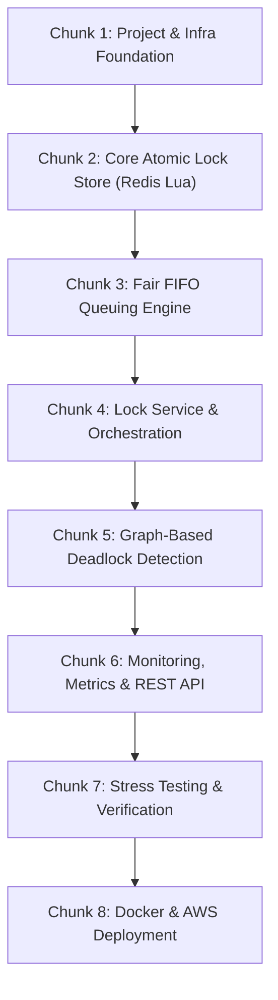

# Distributed Locking Service - Step-by-Step Implementation Roadmap

> **Project Goal:** Build a production-grade, high-concurrency Spring Boot Distributed Locking Service powered by atomic Redis operations (Lua scripting), fair FIFO queuing, graph-based deadlock detection, PostgreSQL metrics tracking, and cloud readiness.

---

## 📌 Implementation Chunks & Milestones

The implementation is broken down into **8 logical, sequential chunks**. Each chunk forms a complete, testable module of the system.

---

### 🧩 CHUNK 1: Project & Infrastructure Foundation
* **Goal:** Configure dependencies, environment, database services (Docker), and base package architecture.
* **Tasks:**
  - [x] Update `pom.xml`: Add Spring Data Redis (Lettuce), Spring Data JPA, PostgreSQL Driver, Spring Validation, Lombok, OpenAPI/Swagger.
  - [x] Create `docker-compose.yml` for local development (Redis + PostgreSQL).
  - [x] Define project structure: `config`, `controller`, `service`, `repository`, `model`, `dto`, `exception`, `util`.
  - [x] Configure `application.properties` for Redis connection pooling, database connectivity, and SLF4J/Logback logging.

---

### 🧩 CHUNK 2: Core Atomic Lock Store (Redis + Lua Scripting)
* **Goal:** Build the low-level atomic locking mechanism in Redis to guarantee no race conditions.
* **Tasks:**
  - [ ] Write Lua script `LUA_ACQUIRE_LOCK`: Check existence, set key with value (UUID owner identifier), set TTL atomically.
  - [ ] Write Lua script `LUA_RELEASE_LOCK`: Verify ownership token before releasing (prevents releasing locks owned by other threads/services).
  - [ ] Implement `RedisLockStore` class with Lettuce / `StringRedisTemplate`.
  - [ ] Write unit tests for `RedisLockStore` (atomic acquire, owner-only release, TTL auto-expiry).

---

### 🧩 CHUNK 3: Fair FIFO Queuing Engine
* **Goal:** Implement queue management for lock requests to prevent thread/service starvation.
* **Tasks:**
  - [ ] Implement `LockQueueManager` using Redis Data Structures (List / Sorted Set).
  - [ ] Support FIFO enqueueing of incoming requests when a lock is currently occupied.
  - [ ] Implement polling/waiting mechanism for queued callers with configurable queue timeout.
  - [ ] Implement queue position inspection API (`getQueuePosition`).
  - [ ] Integration tests verifying fair FIFO order under concurrent request loads.

---

### 🧩 CHUNK 4: Lock Service Orchestration & Error Handling
* **Goal:** Create the core business logic layer coordinating direct acquisition, queue fallback, and error management.
* **Tasks:**
  - [ ] Build `LockService` class with `acquireLock(...)` and `releaseLock(...)`.
  - [ ] Implement custom exceptions: `LockAcquisitionException`, `LockTimeoutException`, `DeadlockException`.
  - [ ] Add `@ControllerAdvice` for global API exception handling and structured error response payloads.
  - [ ] Unit tests for `LockService` business workflows.

---

### 🧩 CHUNK 5: Graph-Based Deadlock Detection Engine
* **Goal:** Detect and break circular wait dependencies ($A \rightarrow B \rightarrow A$) automatically.
* **Tasks:**
  - [ ] Build `LockDependencyGraph` representation to track active lock dependencies (Service $\rightarrow$ Lock $\rightarrow$ Holding Service).
  - [ ] Implement `DeadlockDetector` using Depth-First Search (DFS) or Tarjan's algorithm for cycle detection.
  - [ ] Implement victim transaction resolution (abort/kill conflicting lock request and force release to break cycle).
  - [ ] Write unit & integration tests covering 2-way ($A \leftrightarrow B$) and multi-way ($A \rightarrow B \rightarrow C \rightarrow A$) deadlock scenarios.

---

### 🧩 CHUNK 6: Monitoring, Observability & REST API
* **Goal:** Expose REST endpoints and record operational metrics for audit and monitoring.
* **Tasks:**
  - [ ] Implement `LockMonitor` metrics collector (tracks total acquisitions, wait times, contention rates, deadlock incidents).
  - [ ] Create JPA Entities (`LockAuditLog`, `MetricsSnapshot`) and Spring Data Repositories for PostgreSQL persistence.
  - [ ] Create `LockController`:
    - `POST /api/v1/locks/acquire` - Acquire lock / enter queue
    - `POST /api/v1/locks/release` - Release lock & notify next waiter
    - `GET /api/v1/locks/status/{lockName}` - Query lock status
    - `GET /api/v1/metrics` - Fetch real-time system performance metrics
  - [ ] Configure Swagger UI (`/swagger-ui.html`) for interactive API testing.

---

### 🧩 CHUNK 7: Verification & Comprehensive Stress Testing Suite
* **Goal:** Ensure system stability under extreme concurrency, service crashes, and high load.
* **Tasks:**
  - [ ] Write unit tests to reach >70% code coverage.
  - [ ] Integration tests using Testcontainers (Redis + Postgres containers).
  - [ ] Write high-concurrency performance test suite (1,000+ concurrent requests using `ExecutorService`).
  - [ ] Verify End-to-End Scenarios:
    - Service crash while holding lock (auto-expiry via TTL verification).
    - Deadlock auto-detection & resolution test.
    - FIFO fairness test under heavy contention.

---

### 🧩 CHUNK 8: Containerization & AWS Cloud Deployment
* **Goal:** Package for production and deploy to AWS infrastructure.
* **Tasks:**
  - [ ] Create optimized multi-stage `Dockerfile`.
  - [ ] Document AWS Setup:
    - EC2 Instance setup (Ubuntu 22.04 LTS).
    - RDS PostgreSQL instance provisioning.
    - ElastiCache Redis cluster provisioning.
  - [ ] Setup GitHub Actions CI/CD workflow (`.github/workflows/ci.yml`) for automated build & test.
  - [ ] Conduct final end-to-end verification via AWS deployed endpoint.

---

## 🚀 How We Will Execute Step-by-Step

We will proceed **chunk by chunk**:
1. **Chunk 1**: Project configuration, dependencies (`pom.xml`), Docker setup, and application properties.
2. **Chunk 2**: Building the Lua scripts and `RedisLockStore`.
3. **Chunk 3**: Building the FIFO queue manager.
4. **Chunk 4**: Implementing `LockService` and exception handling.
5. **Chunk 5**: Graph-based deadlock detection engine.
6. **Chunk 6**: REST controller, metrics, and PostgreSQL persistence.
7. **Chunk 7**: Comprehensive testing & concurrency benchmarks.
8. **Chunk 8**: Docker, GitHub Actions & AWS deployment guide.
